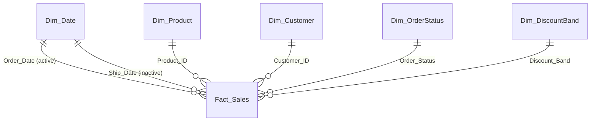

# Global Defense Sales Analytics: End-to-End Power BI Project

> A portfolio-grade analytics project on **500,000 orders / 173B realised revenue**: data audit, star-schema model, Power Query (M), 70+ DAX measures, SQL companion, RFM customer segmentation, a discount what-if model, and a documented 8-page report design.

**Targets:** Data Analyst · Business Analyst · BI Developer · Sales / Commercial Analyst · Revenue / Pricing Analyst
**Stack:** Power BI Desktop · Power Query (M) · DAX · Star-schema modelling · SQL (tested on SQLite; portable to SQL Server / PostgreSQL)

---

## 1. At a glance

| | |
|---|---|
| Orders | 500,000 (Oct 2023 – Sep 2026, fiscal year starts 1 Oct) |
| Scope | 7 countries · 4 regions · 51 products · 8 categories · 16 suppliers · 94,918 customers |
| Realised (Completed) | 400,000 orders · **173.4B revenue · 28.1B profit · 16.2% margin** |
| Model | 1 fact + 5 dimensions + 3 parameter tables · 70+ measures |
| Extras | RFM segmentation · Pareto · concentration (HHI) · discount-cap what-if with break-even attrition |

## 2. Business problem

Leadership needs to know **where revenue and profit come from, what is leaking margin, and where to focus**:

1. How are revenue, profit and margin trending?
2. Which products, suppliers, regions and segments drive profit?
3. How much revenue is lost to returns and cancellations?
4. How do discounts affect profitability, and what would a discount cap be worth?
5. How concentrated is the business (customers, products, suppliers)?
6. Which customers are valuable and slipping away?

## 3. Headline findings (all verified in Python and SQL against the full dataset)

| # | Finding | Evidence |
|---|---|---|
| 1 | **Discounting is the main margin lever** | Margin falls 24.7% → 22.2% → 17.9% → 13.3% → **8.0%** from no discount to 16–20% |
| 2 | **A 10% discount cap is worth ≈ +5.1B profit (+18%)** at constant volume | Pays off unless **>38% of the 190,570 affected orders** walk away (break-even attrition) |
| 3 | **20,979 completed orders lost money**, all at ≥14% discount | But the total loss is only ≈ 0.21B: the real cost is *margin erosion*, not loss-making orders |
| 4 | **15.1% of order value leaks** through returns (10%) and cancellations (5%) | ≈ 32.8B; return rate is ~10% in *every* region, category and segment → a process problem |
| 5 | **Ammunition = 77% of revenue and profit** | 5 ammo products generate 70.5% of profit; 8 of 51 products generate 80% |
| 6 | **Supplier concentration is high** | Top 2 suppliers = 71% of revenue; HHI ≈ 2,656 (>2,500 = highly concentrated) |
| 7 | **Customer concentration** | Top 10% of customers = 46.4% of revenue; 80% of customers are repeat buyers |
| 8 | **Growth is flat** | FY24 58.0B · FY25 57.3B (−1.2%) · FY26 58.1B (+1.3%) |
| 9 | **RFM** | "Champions" (27% of customers) generate 57% of revenue; "High-Value At Risk" (3,863 customers) hold 12.3B of lifetime revenue |

Full narrative and recommendations: [`docs/Case_Study.md`](docs/Case_Study.md).

## 4. Data model (star schema)



All relationships are one-to-many, single direction (dimension → fact). `Dim_Date` is marked as the date table. Order Date is the active relationship; **Ship Date is a role-playing inactive relationship** used via `USERELATIONSHIP`. Disconnected parameter tables (`Discount Cap`, `Attrition`, `Metric Selector`) drive the what-if page. All measures live in a `_Measures` table.

## 5. Repository layout

```
PowerBI_Defense_Sales_Project/
├── README.md
├── data/                  # finished star schema (CSV) - quick-start route
│   ├── Fact_Sales.csv  Dim_Product.csv  Dim_Customer.csv  Dim_Date.csv
│   └── Dim_OrderStatus.csv  Dim_DiscountBand.csv
├── powerquery/            # M scripts - full route from the original Excel file
├── dax/                   # calculated tables, parameters, 70+ measures
├── sql/                   # 15 analysis queries (tested)
├── theme/DefenseNavy_Theme.json
├── validation/            # expected values to reconcile every KPI + SQL outputs
└── docs/                  # build guide, data dictionary, case study, interview prep, resume bullets
```

## 6. How to build it

**Route A: full pipeline (recommended, this is what you talk about in interviews)**
1. Create parameter `FilePath`, load the original `.xlsx` as `Raw` → run the scripts in `powerquery/` in numeric order.
2. Create the tables/parameters in `dax/00_*.dax`, then the measures in `dax/01_Measures.dax`.
3. Follow [`docs/Build_Guide.md`](docs/Build_Guide.md) page by page.
4. Reconcile with `validation/expected_values.csv`.

**Route B: quick start**: load the CSVs from `/data` (pattern in `powerquery/05_Quick_Start_From_CSV.pq`), then steps 2–4.

## 7. Report pages (8 pages + 2 hidden)

| # | Page | Purpose |
|---|---|---|
| 0 | Home / navigation | Title, "as of" date, page buttons, how to read the report |
| 1 | Executive Summary | KPI cards with YoY, trend, region map, category mix |
| 2 | Product & Supplier | Top products, Pareto, category×region matrix, supplier concentration |
| 3 | Customers & Geography | Segment/country comparison, top-10% concentration, decomposition tree |
| 4 | Discount & Profitability | Margin by discount band, loss-making orders, **what-if cap + attrition** |
| 5 | Fulfilment & Leakage | Status funnel, returned/cancelled trend, ship days, return rate heatmap |
| 6 | Customer Segmentation (RFM) | Segment sizes, revenue share, at-risk exposure, customer list |
| 7 | About & Data Notes | Assumptions, definitions, data caveats |
| – | Tooltip: Product (hidden) | Hover card for product visuals |
| – | Drill-through: Customer / Product (hidden) | Detail pages |

## 8. Data audit (do this in Power Query and talk about it)

| Check | Result | Decision |
|---|---|---|
| Rows / nulls / duplicate `Order_ID` | 500,000 / 0 / 0 | No null handling needed |
| `Local_Currency` | Same numeric price scale in all 7 currencies; currency is 1:1 with country | **No FX conversion**; treat as one common unit (stated assumption) |
| `Net_Profit` | = (Price × (1 − Disc) − Cost) × Qty for Completed & Pending; **0 for Returned/Cancelled** | KPIs use **Completed only** |
| Product → Category/Supplier/Cost | Strict 1:1 | Safe `Dim_Product` |
| Customer → Country/Segment | Strict 1:1 | Safe `Dim_Customer` |
| Ship before Order | 0 rows; ship days 1–7, evenly spread | No fix needed |
| `Discount_Applied` | 21 distinct values (0%–20%), rounded to 2 dp | Rounding removes float noise and speeds up DAX |
| Supplier name | "Name (Country)" pattern; one alias ("AWEIL India") | Parsed into `Supplier_Short` and `Supplier_Country` |

## 9. Assumptions & limitations (state these openly)

- **The dataset is synthetic.** Margins, return rates and discount frequencies are almost perfectly uniform across every dimension, and the currency column does not change prices. Saying so is a strength, not a weakness.
- No FX conversion (verified, see audit). Amounts are in one common unit.
- The **what-if is a simple scenario**: it assumes costs are unchanged and, unless you set *Attrition*, that volume is unchanged. It is not a demand-elasticity model.
- **YoY is blank for FY2024**: there is no earlier year in the data.
- **RFM is a static snapshot** as of 1 Oct 2026 on realised orders, so it does not respond to date slicers.
- "Est. Profit Forgone to Leakage" (≈ 5.3B) is an **estimate**: leaked revenue × realised margin.

## 10. What each role should emphasise

| Role | Lead with |
|---|---|
| Data Analyst | Audit, SQL queries, validation against Python/SQL, insights |
| Business Analyst | Business problem, recommendations, what-if quantification, stakeholder-ready pages |
| BI Developer | Star schema, role-playing date, parameters, DAX patterns, performance, RLS, publishing |
| Sales / Pricing Analyst | Discount-margin curve, cap what-if + break-even attrition, concentration, RFM |

## 11. Recommendations

1. **Cap discounts at ~10% and require approval above it.** Worth ≈ +5.1B at constant volume; break-even only if >38% of affected orders are lost.
2. **Fix the returns/cancellation process**: the uniform 10% / 5% rates point at order accuracy, documentation or delivery, not at a product or market.
3. **De-risk supply**: two suppliers carry 71% of revenue (ammunition).
4. **Key-account programme** for the top 10% of customers, plus a win-back campaign for the 3,863 "High-Value At Risk" accounts.
5. **Grow non-ammunition**, which is only 23% of revenue.

---
*Author: [Your Name] · [LinkedIn] · [Email]*
